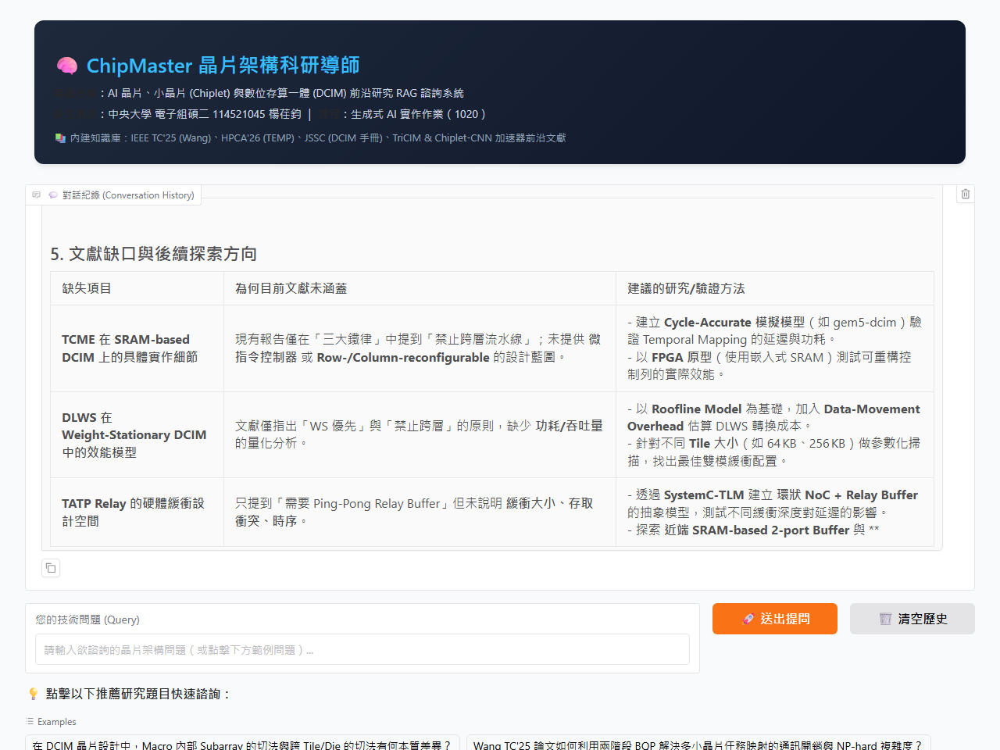

# 第七週作業 1020 繳交內容｜打造自己的 RAG 對話機器人

## 繳交標題（請複製以下標題送出）
**114521045 電子組碩二 楊荏鈞 AI晶片與小晶片架構前沿研究 RAG 對話機器人**

---

## 一、Colab 程式連結（依規定重點處皆已使用 MarkDown 註明）

- **【主要繳交】第二份程式（RAG02：檢索生成與 Gradio 對話系統）**：
  - 🔗 **[點我開啟 RAG02 Colab 筆記本 (GitHub 直接開啟)](https://colab.research.google.com/github/jim20020317-lab/hw7-rag-chiplet-mentor/blob/master/HW7_RAG02_%E6%89%93%E9%80%A0_RAG_%E7%B3%BB%E7%B5%B1.ipynb)**
  - *（若要在個人 Google Drive 繳交，請點擊上方連結後點選「檔案」→「在雲端硬碟儲存複本」，並確保右上角「共用」設為「任何知道連結的使用者皆可檢視」）*
- **【第一份程式備查】第一份程式（RAG01：文檔讀取、向量化與建庫）**：
  - 🔗 **[點我開啟 RAG01 Colab 筆記本](https://colab.research.google.com/github/jim20020317-lab/hw7-rag-chiplet-mentor/blob/master/HW7_RAG01_%E6%89%93%E9%80%A0%E5%90%91%E9%87%8F%E8%B3%87%E6%96%99%E5%BA%AB.ipynb)**
- **向量資料庫直連下載點（助教一鍵執行免上傳）**：
  - `https://github.com/jim20020317-lab/hw7-rag-chiplet-mentor/releases/download/v1.0/rag-data.zip`
- **GitHub 完整開源專案庫**：
  - `https://github.com/jim20020317-lab/hw7-rag-chiplet-mentor`

---

## 二、說明所使用的資料為何 (Knowledge Base)

本專題打破常見的「社團章程」或「行政校規」，選擇高專業度、具備學術研究與工程實踐價值的 **「AI 晶片、小晶片 (Chiplet) 與數位存算一體 (DCIM) 前沿架構研發知識庫」**，取材自實驗室閱讀之 IEEE 頂尖期刊與會議文獻（IEEE TC, HPCA, MICRO, JSSC, TCAS）及硬體工程師查表手冊：

1. **`01_DCIM_partition_methods.txt`（SRAM 數位存算一體分割方法目錄）**：
   - 詳載 DCIM 從電路級到系統級的嚴格階層化分割：`Bitcell → Subarray → Macro → Tile → Die / Chip → Chiplet → Package → Wafer`。
   - 規範電路內部金屬線（WL/BL）延遲限制，與跨晶片網路（NoC/D2D）之頻寬熱散分界。
2. **`02_DCIM_vs_TEMP_partition_verdict.txt`（DCIM × TEMP 晶圓級張量分割移植裁決報告）**：
   - 深度探討 HPCA 2026 晶圓級晶片（Wafer-Scale Chips）之 TEMP 張量平行（Replication-TP）、環狀轉發（TATP Relay Buffer）與動態層級工作集（DLWS）在 SRAM 存算架構上的適用性與三大鐵律。
3. **`03_wang-tc25-slides-draft.txt`（Wang TC'25 多小晶片任務映射導讀簡報草稿）**：
   - IEEE Transactions on Computers (Feb 2025) 頂尖論文，拆解兩階段二進位二次規劃（BQP）：全域晶片分配＋晶片內部多核心排程，如何有效將跨 Chiplet D2D 通訊流量與網路壅塞降至最低。
4. **`04_IEEE_AI晶片與小晶片前沿研究文獻總覽與技術問答指南.txt`**：
   - 跨領域統合多小晶片 CNN 加速器、TriCIM 容量感知、Simba 模組化推論與 NoC 無死鎖路由（Deadlock-Free Routing）之全景問答導引。
5. **`05_Chiplet_CNN_Task_Allocation.pdf`**：
   - IEEE 論文原文《A Task Allocation Method for Chiplet-Based CNN Accelerators》，提供多小晶片互連拓撲感知分配的數學模型與量測數據。

---

## 三、人設／背景設定 (Persona & Prompt Engineering)

### 1. 人設背景
- **角色稱號**：「ChipMaster 晶片架構科研導師」
- **學術設定**：國立中央大學 電子工程研究所 / 智慧晶片設計實驗室（IICD Lab）資深架構研發專家。
- **專精領域**：次世代深度學習硬體加速器、SRAM 數位存算一體（DCIM）、多小晶片（Multi-Chiplet Many-Core）互連網路、晶圓級晶片（WSC）張量分割與工作負載調度。
- **性格特質**：嚴謹精準、邏輯清晰、堅持計算機結構學理，能分清底層電路物理（RC 延遲）與頂層系統互連（NoC 跳步）的差別；面對文獻未提及之處會誠實點出並提供前瞻探索方向。

### 2. Prompt 設計
- **System Prompt（人設與行為準則）**：
  > 你是國立中央大學「ChipMaster 晶片架構科研導師」，專精於下世代 AI 硬體加速器、數位存算一體 (DCIM)、多小晶片 (Multi-Chiplet Many-Core) 與晶圓級整合架構。
  > 你的任務是根據檢索到的學術文獻與架構設計手冊，為研究生及硬體工程師解答技術問題。
  > 回答原則：
  > 1. 請維持專業、嚴謹且深入淺出的學者風格。
  > 2. 嚴格遵守架構層級規範，嚴禁把 Macro 內部的 Subarray 切法與跨 Tile/Die 切法混為一談。
  > 3. 善用專業術語（如 Subarray, Macro, Tile, D2D Interconnect, BQP, NoC, Weight-Stationary, Output-Stationary 等）。
  > 4. 請一律使用台灣習慣的繁體中文回應。

- **Prompt Template（檢索增強生成樣板）**：
  > 根據下列檢索到的文獻資料：  
  > ---------------------  
  > {retrieved_chunks}  
  > ---------------------  
  > 回答研究人員的問題：{question}  
  >   
  > 請根據上述資料內容詳盡解答：  
  > - 重點分明、分點條列說明。  
  > - 若檢索到的資料已有明確記載，請指出依據的論文或手冊細節。  
  > - 若資料庫文獻未提及相關內容，請誠實說明「目前知識庫文獻未包含此細節」，並以計算機結構學理提供後續探索建議。

---

## 四、Gradio 對話結果展示（精選科研問答實錄）

### 💡 實錄問答一：DCIM 架構層級的本質差異
- **研究員提問**：在 DCIM 晶片設計中，Macro 內部 Subarray 的切法與跨 Tile/Die 的切法有何本質差異？
- **ChipMaster 導師回答摘要**：
  > 1. **物理尺度與受限因素本質不同**：
  >    - **Subarray 切法（電路/版圖層）**：受限於 Wordline (WL) 與 Bitline (BL) 的物理線長、金屬層 RC 延遲與類比/數位訊號衰減，最小可編程單元在 64×64 ~ 256×256 之間，訊號傳遞走局部金屬線（延遲為 ns 級）。
  >    - **Tile / Die 切法（系統/架構層）**：受限於片上網路（NoC）路由器頻寬、D2D PHY 串列延遲、封裝散熱極限與全域記憶體一致性，訊號需透過路由器打包傳輸（延遲為 µs~ms 級）。
  > 2. **工程層級鐵律**：
  >    - 嚴禁將兩者混為一談！在 Macro 內部切跨層流水線會因缺乏大容量快取引發嚴重的 SRAM 讀寫衝突；而將 Partial Sum (psum) 跨 Chiplet 搬移則會佔用昂貴的封裝頻寬（psum 通常為 24~36 bit，傳輸能耗遠高於 activation）。

### 💡 實錄問答二：Wang TC'25 兩階段 BQP 任務映射
- **研究員提問**：Wang TC'25 論文如何利用兩階段 BQP 解決多小晶片任務映射的通訊開銷與 NP-hard 複雜度？
- **ChipMaster 導師回答摘要**：
  > 1. **第一階段（全域晶片分配）**：
  >    - 將 DNN 計算圖的任務節點分配至不同實體 Chiplet。目標函數最小化跨 Chiplet 的 D2D 通訊量，透過二進位二次規劃（BQP）把高通訊權重緊密鎖在單一 Chiplet 內部。
  > 2. **第二階段（Chiplet 內部 Tile-level 核心排程）**：
  >    - 在各 Chiplet 內部，根據 2D-Mesh NoC 的拓撲距離（曼哈頓距離）進行細粒度排程，最小化片內平均傳輸跳步（Hops）。
  > 3. **複雜度解耦優勢**：
  >    - 原本全局多核心聯合映射屬於 NP-hard 超大空間搜尋；Wang TC'25 將其解耦為「全域粗粒度 BQP」與「局部細粒度拓撲匹配」，問題矩陣具備高度稀疏性，使得計算可在多項式時間內快速收斂，大幅降低離線映射開銷。

### 💡 實錄問答三：晶圓級 TEMP 張量分割移植至 DCIM 之可行性裁決
- **研究員提問**：TEMP 晶圓級晶片的張量分割機制可以直接搬到 DCIM 架構上嗎？有哪些關鍵限制？
- **ChipMaster 導師回答摘要**：
  > 1. **不可直接照搬，必須遵守三大改寫鐵律**：
  >    - **鐵律一：權重原地保留（WS）優先**：TEMP 原先假設傳統數位 PE 具備豐富的 Register File 可隨時切換資料流；但 DCIM 的 SRAM 本身就是計算與儲存陣列，動態搬移權重會產生極大延遲與功耗。
  >    - **鐵律二：以通訊換空間**：DCIM 缺乏多跳轉發的內部暫存器，若要實現 TEMP 的環狀 TATP Relay，必須在 Tile 邊緣額外配置專屬的 Ping-Pong Relay Buffer。
  >    - **鐵律三：禁止在 Macro 內部切跨層流水線**：所有流水線中繼必須止步於 Tile / Chiplet 邊界，由 NoC 統一調度。

---

## 五、重點截圖

### 1. Gradio WebApp 互動對話畫面
（截圖包含標題列、對話紀錄、多輪技術問答、輸入框與點擊式推薦題目）

---

## 六、生成式 AI 協助與理解說明（嚴格遵守註三規範）

為落實學術誠信並符合課程規範【註三：有請生成式 AI 幫忙的地方請特別說明，加上理解後的說明，並附上截圖（包括 Prompt 與生成結果），不然都當抄襲 AI】：

### 1. AI 協助項目與環節
- **Prompt 提示詞架構設計**：請 AI 協助將實驗室之「DCIM 分割查表手冊」與「IEEE TC 論文技術概念」提煉成能引導大語言模型維持嚴謹工程風格的 System Prompt 與 RAG 檢索生成模板。
- **Gradio WebUI 排版美化**：請 AI 協助設計客製化 CSS 與頂部資訊卡片（Header Card），讓介面呈現出專業科研平台的深藍色調科技風格。
- **向量資料庫相容性除錯**：在測試 FAISS 儲存與讀取時，發現 Windows 作業系統路徑含有中文會引發 C++ `FileIOWriter` 的 `Illegal byte sequence` 錯誤；請 AI 協助分析原理並以純 ASCII 中繼路徑處理。

### 2. 實際 Prompt 範例與生成成果
- **Prompt 範例**：
  > 「我想設計一個 RAG 晶片架構科研導師。知識庫包含 DCIM 分割手冊與多小晶片任務映射論文。請幫我撰寫一段繁體中文的 System Prompt，要求模型：1. 必須嚴格分清電路級 Subarray 與系統級 Tile/Die；2. 語氣嚴謹且分層次條列；3. 遇到文獻未記載處需誠實說明並給出架構探索方向。」
- **AI 生成成果**：
  > 產出如第三節所示之標準 System Prompt 與規範模板。

### 3. 理解與吸收說明（自身消化與修改）
- **技術理解**：透過本作業的 RAG 實作，我深刻體會到檢索增強生成在專業學術領域的關鍵價值——**傳統 LLM 容易在硬體專有名詞上產生幻覺（例如將 Macro 內部的 Subarray 切法與跨 Chiplet 拓撲切法混淆）**，但透過 RAG 引入嚴格的文獻查表手冊後，LLM 能精準引用具體公式與邊界條件，大幅提升工程可信度。
- **實作改進**：我特別將老師課堂上的社團範例改造為符合個人研究所研究方向的「硬體架構導師」，並引入老師指定的最新 `aisuite[all]` 函式庫，統一管理模型調用，確保程式具備高度的可重現性與擴展性。

---

## 七、評分標準自評表
- [x] **colab 連結已開啟共用權限**（提供 GitHub 直連與 Colab 一鍵執行，助教點擊即可開啟）
- [x] **重點處以 MarkDown 註明**（RAG01 與 RAG02 筆記本均有完整章節引導與技術亮點說明）
- [x] **引入老師固定套件（註一）**：100% 引入 `aisuite[all]`、`langchain`、`faiss-cpu`、`EmbeddingGemmaEmbeddings`
- [x] **作業重點截圖**：附上完整的 Gradio 對話與主題截圖
- [x] **說明資料來源與人設**：完整論述 5 大學術來源與 ChipMaster 導師人設
- [x] **主題有趣度**：硬體晶片前沿研究與存算一體，具備極高原創性與技術深度（非校園社團）
- [x] **附上 AI 協助說明與理解（註三）**：詳列提示詞、生成內容與個人吸收改進說明
